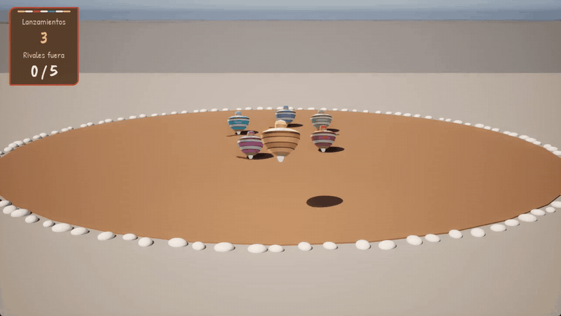
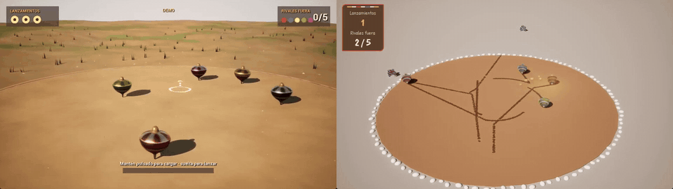
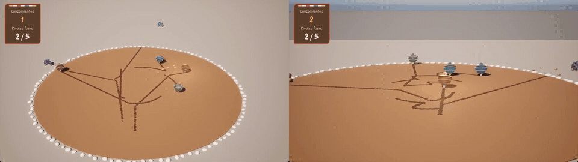
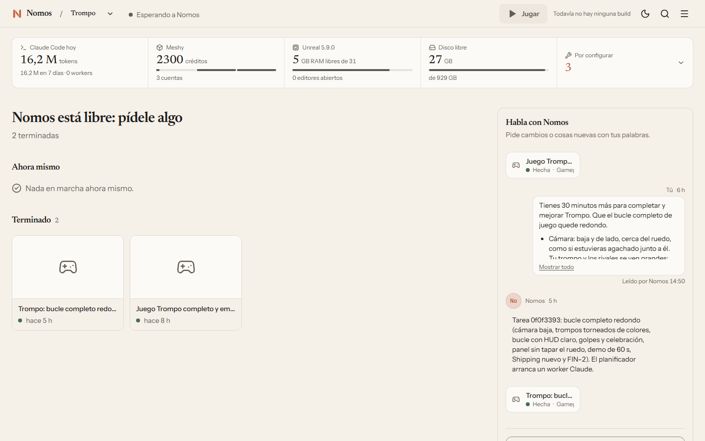

<p align="center">
  
</p>

<p align="center"><b>Haz juegos de Unreal Engine con un equipo de agentes de Claude Code: tú pides, Nomos reparte, revisa y empaqueta.</b><br>
Para quien quiere sacar un juego pequeño (una jam, un prototipo) sin renunciar al acabado.</p>

<p align="center"><i>A production director for Unreal Engine games built on Claude Code agents: brief in, packaged game out.</i></p>

## Hecho con Nomos

<p align="center">
  
  
</p>
<p align="center"><sub><i>Trompo</i>, hecho con Nomos · el mismo encargo sin Nomos (izquierda) y con Nomos (derecha)</sub></p>

Mismo encargo, mismo PC, Unreal 5.9: un agente Opus solo frente a Nomos. Dos jueces a ciegas puntuaron capturas del `.exe`.

| Trompo | Agente solo | Nomos |
|---|---|---|
| Nota de los jueces | 18/30 | **23,5/30** |
| Del encargo al `.exe` | 39 min 49 s | **30 min 54 s** |
| Fallos de acabado | 3 | **0** |
| Intervenciones humanas | 0 | 0 |

Con 30 minutos más y sin intervenciones, Nomos cerró el bucle: cámara baja, trompos grandes y tres lanzamientos.

<p align="center"></p>

**En el primer juego Nomos perdió.** Con *Candela* el agente solo sacó 22/30 y Nomos 14/30: el juego era oscuro y no se leía.
Por eso un juego pequeño va ahora a un solo worker, el worker y el revisor miran capturas, una comprobación mide la imagen y la
semilla arranca con luz, cielo y cámara. Una pasada por rama y nadie jugó con ratón: datos completos y límites en
[comparativa-trompo.md](docs/demo/comparativa-trompo.md) y [comparativa.md](docs/demo/comparativa.md).

## Qué hace

- **Del encargo al juego empaquetado.** Escribes lo que quieres en el chat o en el panel; el director lo convierte en tareas
  con criterios, las reparte, pide revisión independiente y cierra con un `.exe`.
- **Un worker por juego pequeño.** Lo que cabe en una hora lo hace un solo worker; se parte solo si hace falta.
- **Acabado obligatorio.** Nada por defecto del motor (HUD con fuentes propias, pantalla de carga, texturas cocinadas):
  `revisar_acabado.py` bloquea el FIN si falta algo.
- **Una comprobación que mira la imagen.** `revisar_imagen.py` detecta negro puro, pantalla vacía o un protagonista que no se lee.
- **Equipo sincronizado por Git.** Cada persona con su Nomos en su PC; cada minuto se trae lo que publican los demás.
- **Build web** (WebAssembly + WebGPU) con el motor del Launcher, sin compilar Unreal desde fuente.
- **Herramientas:** MCP de Unreal 5.9, Meshy con varias cuentas para piezas hard surface y sonido de WeLoveIndies con tu sesión.
- **Panel local** con tarjeta de estado: qué se hace, quién lo hace y qué espera de ti.

<p align="center"></p>

## Requisitos

- **Windows 11**, **Node.js 25+**, **Git** con **Git LFS**, **Claude Code** (`claude` en el PATH).
- **Unreal Engine 5.8 o 5.9** (el 5.9 MegaJam Preview es inestable según Epic: [ue59-preview.md](skills/ue-oficio/references/ue59-preview.md)).
- Opcionales: [Orca](docs/workers-proveedores.md) (terminales visibles para los workers), emsdk 6.0.10 (build web),
  Python con Pillow (comprobación de imagen), ffmpeg (vídeos), cuenta de Meshy, cuenta de WeLoveIndies.

## Empezar en cinco minutos

```powershell
git clone https://github.com/Lozadaa/nomos-for-unreal nomos
cd nomos
npm --prefix panel ci; npm run build                  # el panel; el servicio no tiene dependencias npm

node skills/nomos/scripts/nomos.ts nuevo MiJuego      # juego C++ con la semilla y Nomos dentro, en Documentos\Unreal Projects
cd "$env:USERPROFILE\Documents\Unreal Projects\MiJuego"
.\Scripts\compilar.ps1
.\nomos.cmd doctor --data .nomos                      # dice qué falta y qué se pierde sin ello
claude                                                # y dentro: /nomos
```

`/nomos` levanta el servicio en `127.0.0.1`, abre el panel y espera. Manda el primer encargo por el chat, por ejemplo:
*«Un juego de trompos: lanzas el tuyo y ganas si echas a los demás del ruedo. Cámara baja y de lado, que se lea a 1280×720.»*

Para usar `/nomos` en un juego que no salió de `nomos nuevo`, enlaza la skill una vez:

```powershell
New-Item -ItemType Junction -Path "$env:USERPROFILE\.claude\skills\nomos" -Target "<ruta a nomos>\skills\nomos"
```

o mete Nomos en el repo del juego con `node service/src/cli.ts embed "<ruta al juego>"` ([referencia](docs/referencia.md)).

## Equipo y cuentas

- **Jam en equipo:** [docs/jam-equipo.md](docs/jam-equipo.md) (instalar, clonar, elegir frente, prueba de 10 minutos).
- **Meshy con varias cuentas:** `powershell -ExecutionPolicy Bypass -File scripts\guardar-claves-meshy.ps1`. Las claves se
  cifran con DPAPI en tu usuario de Windows y no van a ningún repositorio.
- **Sonido de WeLoveIndies:** `nomos sonido login` abre un Chrome aparte para que entres tú; luego `nomos sonido buscar`,
  `bajar` e `importar` ([cómo](docs/investigacion/weloveindies.md)).

## Documentación

[Referencia técnica](docs/referencia.md) (panel, CLI, configuración, pruebas, seguridad) ·
[skill del director](skills/nomos/SKILL.md) · [oficio de Unreal](skills/ue-oficio/SKILL.md) ·
[build web](skills/ue-oficio/references/web.md) · [MCP de Unreal 5.9](docs/investigacion/mcp-59.md) ·
[estado de entregas](docs/estado-entregas.md)

## Estado y límites

Funciona de punta a punta en un PC: encargo, workers, revisión, acabado y `.exe`. Sin probar todavía:

- Dos máquinas reales con GitHub y Git LFS (la guía de equipo trae la prueba para hacerla).
- El juego web en móviles, Firefox, Safari o subido a itch.io; se probó en Chromium de escritorio con WebGPU.
- El inicio de sesión y una descarga reales de WeLoveIndies.
- Nadie ha jugado los juegos de las comparativas con ratón ni ha oído su sonido: se midió en modo demo.

## Licencia y créditos

[MIT](LICENSE). Fuentes del panel (Newsreader, Instrument Sans, Geist Mono) y de la semilla (Caveat Brush, Patrick Hand)
bajo SIL Open Font License. Logo dibujado con Codex para este proyecto. Unreal Engine es marca de Epic Games; Nomos no está
afiliado a Epic Games ni a Anthropic.
