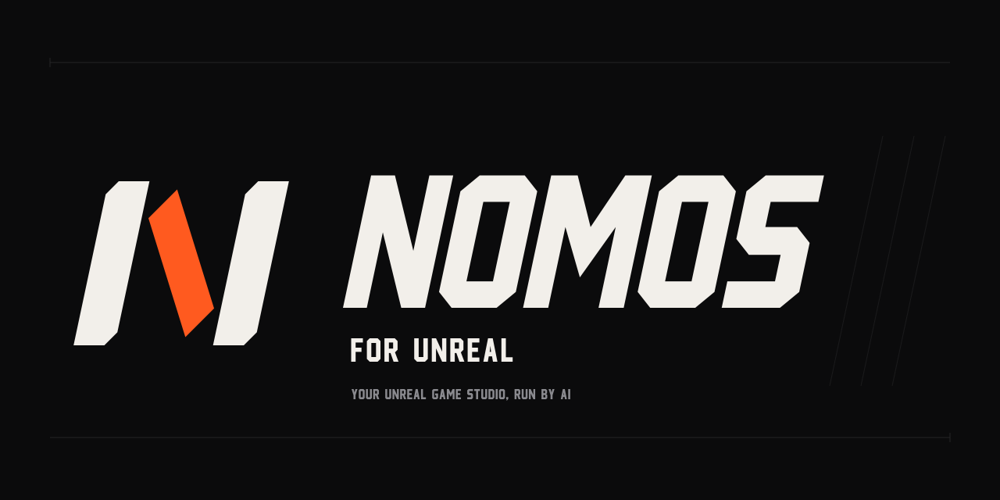
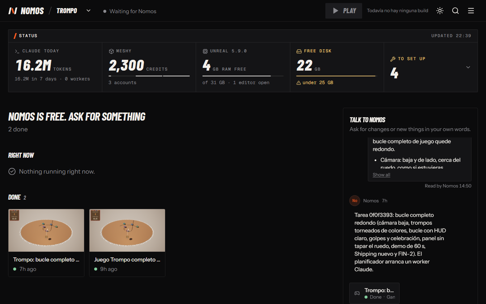

<p align="center">
  
</p>

**Describe a small game in plain words. A team of AI agents builds it in Unreal Engine and gives you a game you can run.**

- You write what you want; Nomos plans the work, builds it and checks it.
- Every piece is reviewed by a second agent before it counts as done.
- The game has to look finished: its own fonts, a loading screen, a picture you can read.
- You follow along in a web panel and only step in when a decision is yours.

<p align="center"></p>

## Install

On Windows, paste this into PowerShell:

```powershell
irm https://raw.githubusercontent.com/Lozadaa/nomos-for-unreal/main/install.ps1 | iex
```

You need Unreal Engine 5.8 or 5.9 and [Claude Code](https://claude.com/claude-code). The installer tells you if anything else is missing.

Other platforms and manual setup are in the [install guide](docs/en/install.md).

## Make your first game

1. Create a project: `nomos nuevo MyGame`. It appears in `Documents/Unreal Projects`.
2. Open that folder in Claude Code and type `/nomos`. A panel opens in your browser.
3. Tell it what you want in the panel chat, for example:

> A spinning-top game: launch yours and win by knocking the others out of the ring.

About half an hour later the panel shows the task as done and the finished game is in the project folder.

## Does it help?

We gave the same idea to one AI agent working alone and to Nomos. Two judges scored the games without knowing which was which.

| | Agent alone | Nomos |
|---|---:|---:|
| Score | 18 / 30 | **23.5 / 30** |
| Time to a finished game | 40 min | **31 min** |
| Unfinished-looking parts | 3 | **0** |

This is a single test, and Nomos lost the one before it. The [full results](docs/en/results.md) cover both.

## Limits

- Tested on Windows 11 only.
- The panel is in English, but the commands and Nomos's own messages are in Spanish.
- It uses your own Claude Code plan, and a game uses a lot of it.
- Team play across two real computers has not been tested yet.

## More

- [Install guide](docs/en/install.md)
- [Working as a team](docs/en/team-jam.md)
- [Reference](docs/en/reference.md)
- [Report a problem](https://github.com/Lozadaa/nomos-for-unreal/issues)
- [MIT license](LICENSE). Nomos is not affiliated with Epic Games, Anthropic or OpenAI.
